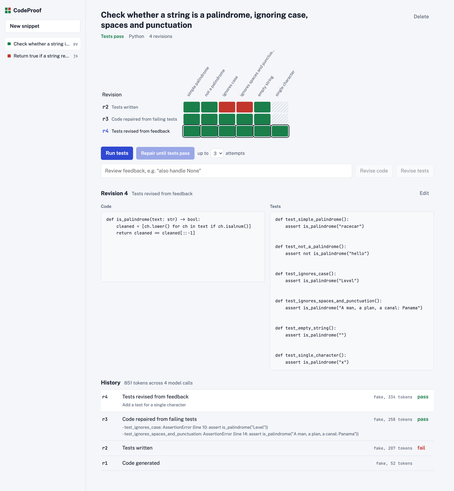
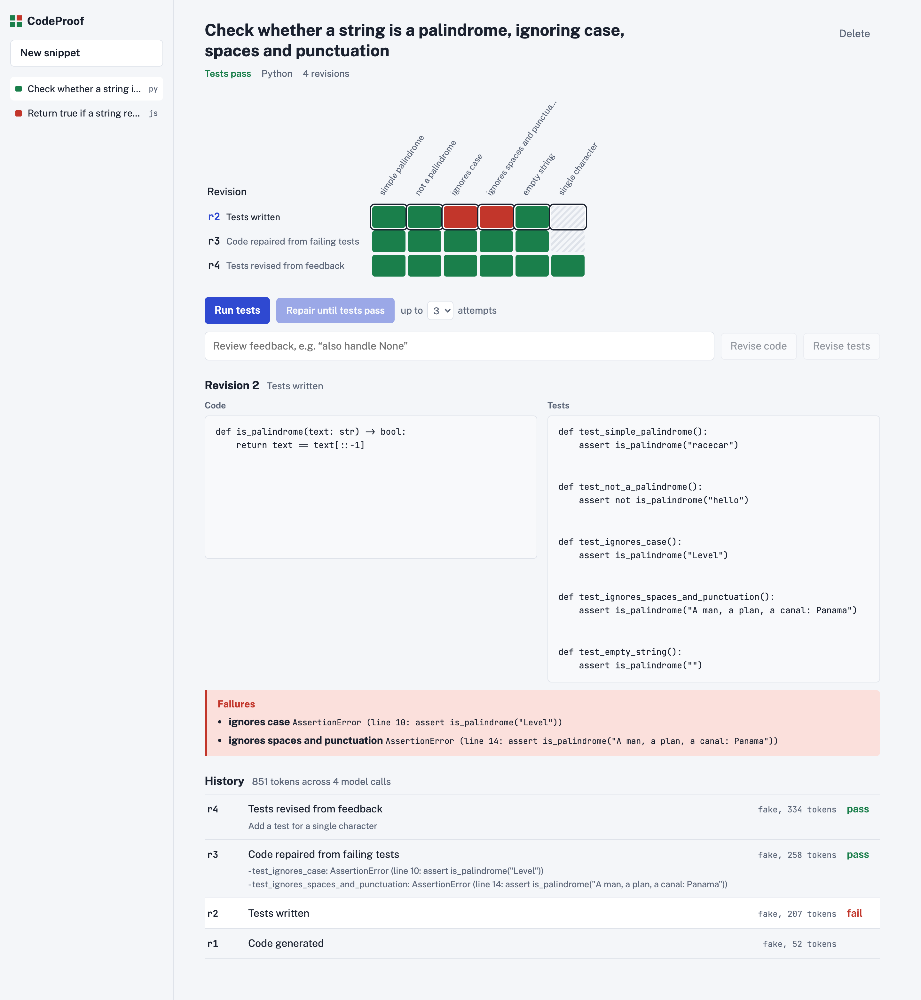
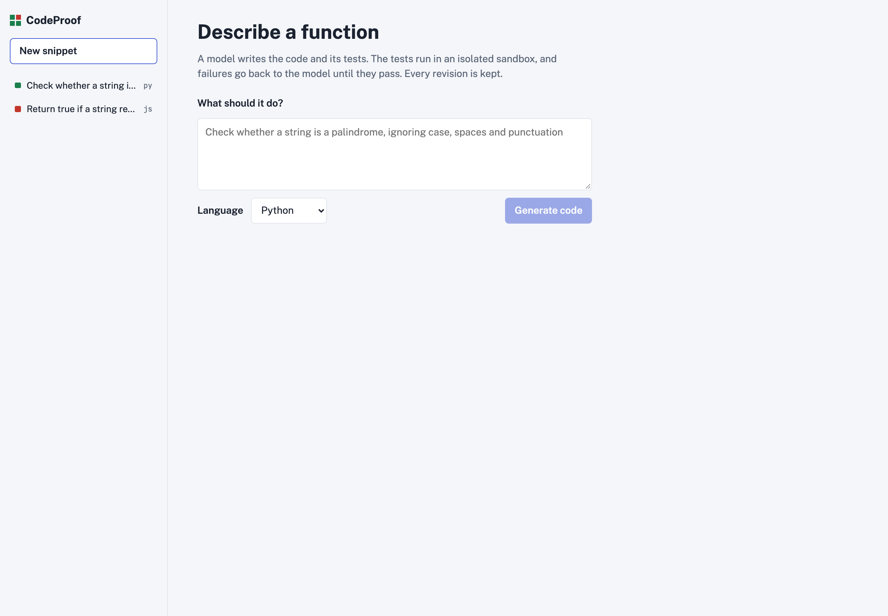

# CodeProof

[](https://github.com/hiteshkalwani/codeproof/actions/workflows/ci.yml)


**LLM-generated code you don't have to take on trust.** Describe a function, and a model writes the code and its tests. The tests run in a locked-down sandbox. When they fail, the failures go back to the model, which may change the code but never the tests, until they pass or the attempt budget runs out. Every revision is kept, with the model and token cost that produced it.

<picture>
  <source media="(prefers-color-scheme: dark)" srcset="docs/screenshots/snippet-dark.png" />
  
</picture>

The **test matrix** is the core of the UI. Each row is a revision and each column is a test. Above, `r2` fails *ignores case* and *ignores spaces and punctuation*. The repair loop produces `r3`, which passes everything. A reviewer then asks for a single-character test, which becomes `r4`.

## Why

Once most new code is written by a model, the bottleneck is review. Reading every generated line with full attention doesn't scale, and "the model said it works" isn't evidence. CodeProof splits the work:

- **People review intent.** Do the tests capture what we actually want? Feedback goes to *Revise tests*, or the tests are edited by hand.
- **The machine checks behaviour.** Run, read the failures, repair, run again, all recorded.
- **The tests are frozen during repair**, so the model can't make them pass by weakening them.

| Inspect any failing run | Start from a description |
|---|---|
|  |  |

<sub>Screenshots are from the production build (`make up`) in demo mode: the model is scripted (`LLM_PROVIDER=fake`), and the tests really ran in the Docker sandbox.</sub>

## Quick start

Requires Docker.

```bash
make up                    # PostgreSQL + API + UI on http://localhost:8080
```

No API key is needed: `.env` starts in demo mode, with a scripted model whose first draft has a bug, so you can watch the full loop. To use a real model, set these in `.env` and run `make up` again:

```env
LLM_PROVIDER=openai
OPENAI_API_KEY=sk-...
LLM_CODE_MODEL=gpt-4o        # writes and repairs code
LLM_TEST_MODEL=gpt-4o-mini   # writes tests (cheaper)
```

Local development without Docker for the app itself (the sandbox still needs Docker):

```bash
make install
make dev-api     # Django on :8000, SQLite, scripted model
make dev-web     # Vite on :5173, proxies /api
```

## How it works

```
description ─► generate code ─► write tests ─► run in sandbox ─► pass ─► done
                                    ▲                │ fail
                         (human revises tests)       ▼
                                             repair code, tests frozen ─► run again (≤ N attempts)
```

- **Revisions are immutable.** Generating, repairing, revising from feedback or editing by hand each adds a revision rather than overwriting one.
- **Sandbox:** each run gets a fresh container with no network, a read-only filesystem, the `nobody` user, all capabilities dropped, memory/CPU/PID limits and a 10s timeout. Small runner scripts report a result per test, including the failing `assert` line.
- **Model per task:** a stronger model for code, a cheaper one for tests, set in one place (`prompts.py`).
- **Bounded cost:** the repair budget is capped, writes are rate limited, and every revision records its token usage.

See **[docs/ARCHITECTURE.md](docs/ARCHITECTURE.md)** for the design decisions, the security trade-off of the Docker socket, and the known limitations.

## API

Every action returns the full snippet with its revisions and runs.

| Method | Path | Does |
|---|---|---|
| `GET` | `/api/snippets/` | List with status (`passing`, `failing`, `untested`) |
| `POST` | `/api/snippets/` | `{description, language}` → generate the first revision |
| `GET` / `DELETE` | `/api/snippets/{id}/` | Detail / delete |
| `POST` | `/api/snippets/{id}/tests/` | Write tests, or revise them with `{feedback}` |
| `POST` | `/api/snippets/{id}/improve/` | Revise code with `{feedback}` |
| `POST` | `/api/snippets/{id}/edit/` | Hand edit `{code, tests}` as a new revision |
| `POST` | `/api/snippets/{id}/run/` | Run the latest revision's tests |
| `POST` | `/api/snippets/{id}/repair/` | `{max_attempts}`: run, and repair until green |

Errors: `400` validation, `409` the step doesn't fit the current state (for example, running with no tests), `429` rate limited, `502` model failure, `503` sandbox unavailable.

## Tests

```bash
make test
```

- **Backend (35, pytest):**
  - the runner scripts for both languages
  - the output parser
  - every API flow, including the full repair loop and its attempt cap
  - a query-count check on the list endpoint
  - real Docker isolation tests: no network, read-only filesystem, an infinite loop gets killed
- **Frontend (4, Vitest):** the matrix builder.

CI runs it all against PostgreSQL on every push, plus a missing-migration check, ruff, a type-checked frontend build and both image builds.

## Project layout

```
backend/
  config/                 settings (env-driven), urls
  snippets/
    models.py             Snippet → Revision → TestRun
    services/             workflow (use cases), prompts, llm client, scripted model
    sandbox/              executor + runner.py / runner.js (run inside the container)
    views.py              DRF viewset, error mapping, throttling
    tests/
frontend/
  src/                    App.tsx, matrix.ts (+ tests), api.ts
docs/                     ARCHITECTURE.md, screenshots
docker-compose.yml        db + api + web
```

## Stack

Django 5.2, Django REST Framework, PostgreSQL 17, React 19 + TypeScript (Vite), Docker SDK, OpenAI API, gunicorn, nginx, GitHub Actions.

## License

MIT. See [LICENSE](LICENSE).
